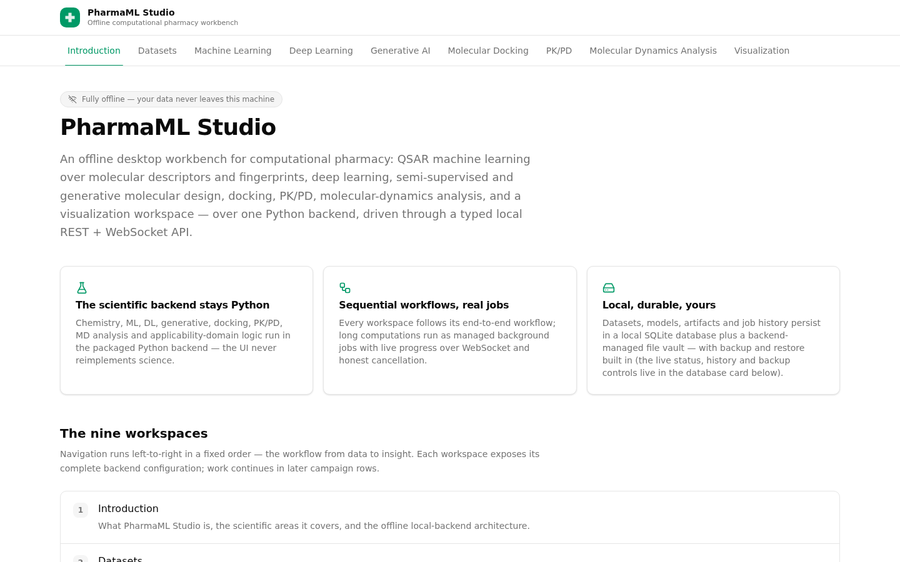

<p align="center">
  
</p>

<div align="center">

# PharmaML Toolkit

**Open-source Python tools for molecular data, pharmaceutical modeling, and research workflows.**

[](https://github.com/MrMMA2004/pharma-ml-toolkit/actions/workflows/ci.yml)
[](pharma-ml-toolkit/VERSION)
[](pharma-ml-toolkit/pyproject.toml)
[](LICENSE)

[Start here](#start-here) · [Research workflows](#research-workflows) · [Scientific use and limits](#scientific-use-and-limits) · [Interfaces](#choose-an-interface) · [Documentation](#documentation)

</div>

---

## About

PharmaML is a local-first Python toolkit for **cheminformatics, QSAR and machine learning, molecular docking, PK/PD calculations, biological-response analysis, and scientific visualization**. Use the Python API or CLI in scripts and notebooks; the React/Tauri Studio and Next.js console are separate applications with their own documented scope, not alternate interfaces with assumed feature parity.

The core toolkit does not require a cloud account or API key. Individual workflows may need optional Python packages, external engines, or suitable input data. The software is for research and education—not clinical decision support, a validated medical device, or a substitute for domain review.

## Start here

The installable Python package is in the **inner** `pharma-ml-toolkit/` directory. This quickstart uses the pinned core dependencies and a bundled example CSV; it does not require RDKit, a GUI, or an external dataset.

**1. Clone the repository and enter the package directory**

```bash
git clone https://github.com/MrMMA2004/pharma-ml-toolkit.git
cd pharma-ml-toolkit/pharma-ml-toolkit
python -m venv .venv
```

**2. Activate the environment and install the core toolkit**

```bash
# macOS / Linux
source .venv/bin/activate
python -m pip install -r requirements.txt
python -m pip install --no-deps -e .
```

In Windows PowerShell, activate with `.venv\Scripts\Activate.ps1`, then run the same two installation commands. The pinned `requirements.txt` is the project's tested snapshot; optional extras and other installation routes are described in the [installation guide](pharma-ml-toolkit/README.md#installation).

**3. Inspect a bundled dataset**

```bash
pharmaml data inspect --data examples/data/qsar_classification.csv --target activity --head 3
```

This reports basic file and target information and prints three rows; it does not change the input file. Substitute your own CSV, TSV, or Excel path and target column. Run `pharmaml --help` to see the available command groups.

<details>
<summary><strong>Try a small Python API example</strong></summary>

```python
from pharmaml.pharma.pk import half_life

# First-order elimination rate constant: 0.35 per hour
print(f"Half-life: {half_life(0.35):.2f} hours")
```

This illustrates the equation `t½ = ln(2) / kₑ`; it is not a patient-specific estimate or dosing recommendation. See the [PK workflow notebook](pharma-ml-toolkit/examples/complete_pk_workflow.ipynb) for a broader example.

</details>

## Research workflows

Use the guides to review each workflow's inputs, assumptions, optional dependencies, and limits. Example notebooks use bundled data unless stated otherwise.

- **Data review and split design** — inspect tables, review data quality, and check exact identifier overlap across named splits. [Data-quality audit notes](pharma-ml-toolkit/docs/RESEARCH_WORKFLOWS.md#data-quality-audit) · [Data splitting guide](pharma-ml-toolkit/docs/DATA_SPLITTING.md)
- **QSAR and machine learning** — prepare features, train models, and examine validation and uncertainty workflows. [ML notebook](pharma-ml-toolkit/examples/complete_ml_workflow.ipynb) · [Nested validation](pharma-ml-toolkit/docs/RESEARCH_WORKFLOWS.md#nested-validation)
- **Cheminformatics** — molecular descriptors, fingerprints, similarity, and molecular-format workflows. [API and module index](pharma-ml-toolkit/docs/INDEX.md) · [Generative workflow notebook](pharma-ml-toolkit/examples/complete_generative_workflow.ipynb)
- **Molecular docking** — prepare inputs and inspect docking campaigns; engine-dependent execution is optional. [Docking notebook](pharma-ml-toolkit/examples/complete_docking_workflow.ipynb) · [Read-only Vina campaign inspection](pharma-ml-toolkit/docs/RESEARCH_WORKFLOWS.md#inspecting-an-interrupted-vina-campaign)
- **PK/PD** — inspect calculations, concentration–time data, and model assumptions. [PK notebook](pharma-ml-toolkit/examples/complete_pk_workflow.ipynb) · [PK analysis script](pharma-ml-toolkit/examples/run_pk_analysis.py)
- **Biological response** — analyze cell-line drug-response tables and related expression or biomarker data. [Cell-line workflow notebook](pharma-ml-toolkit/examples/complete_cellline_workflow.ipynb)
- **Visualization and reporting** — plot and export analysis artifacts. [Research workflow guide](pharma-ml-toolkit/docs/RESEARCH_WORKFLOWS.md) · [Molecular-dynamics visualization notes](pharma-ml-toolkit/docs/MD_VISUALIZATION.md)

Browse the [examples directory](pharma-ml-toolkit/examples/) for notebooks and scripts. Files ending in `_no_output` are compact notebook variants without saved cell outputs.

## Scientific use and limits

A sound analysis usually moves from **data review → split design → training → held-out evaluation → reporting**. Software can make these steps easier to inspect; it cannot establish that a study design, dataset, model, or result is scientifically valid.

- **Plan splits before model selection.** Choose a separation unit appropriate to the question—such as scaffold, compound, patient, or batch. Exact-key overlap checks catch only the identifiers supplied; they do not prove independence or rule out all leakage.
- **Keep held-out data held out.** Fit preprocessing and models on training data. Reserve validation, calibration, and test sets for their stated roles. See the separate-file workflows for [regression intervals](pharma-ml-toolkit/docs/RESEARCH_WORKFLOWS.md#held-out-regression-uncertainty) and [classification sets](pharma-ml-toolkit/docs/RESEARCH_WORKFLOWS.md#held-out-classification-uncertainty). In-memory summaries alone cannot verify independence from model fitting or selection; the archived PySide6 Statistics-tab procedures in the workflow guide are not features of current Studio.
- **Treat uncertainty as conditional on assumptions.** Conformal marginal coverage depends on exchangeability; subgroup estimates are empirical, not conditional guarantees. Small, shifted, or dependent groups can make comparisons unstable.
- **Interpret scores in context.** A docking score is not a measured binding affinity; a predicted activity or generated-molecule objective is not experimental confirmation. PK/PD outputs depend on model structure, units, inputs, and parameter assumptions.
- **Keep provenance honest.** Run records, declared manifests, and [checkpoint diagnostics](pharma-ml-toolkit/docs/RESEARCH_WORKFLOWS.md#checkpoint-inspection) document different kinds of evidence. A declaration is not an observed training record; matching hashes do not prove reproducibility, correctness, or validity. Review metadata for sensitive information before sharing.
- **Check operational boundaries.** Docking execution requires a compatible engine and appropriate inputs. The [campaign inspector](pharma-ml-toolkit/docs/RESEARCH_WORKFLOWS.md#inspecting-an-interrupted-vina-campaign) is read-only; it does not resume a campaign. Python API capabilities and checkpoint limits do not imply matching controls in either desktop or web-console interface.

For supported checkpoint objectives and refusal behavior, see the [genetic checkpoint limits](pharma-ml-toolkit/docs/CHECKPOINT_SCHEMA.md#genetic-checkpoint-compatibility-and-limits). Verify units, data rights, licenses, and intended-use requirements independently.

## Choose an interface

| Interface | What it is | How to begin |
| :--- | :--- | :--- |
| **Python package and CLI** | The core toolkit for scripts, notebooks, and local analysis. | Follow [Start here](#start-here), then run `pharmaml --help`. |
| **PharmaML Studio** | A separate React + Tauri 2 desktop application with nine workspaces and a local FastAPI sidecar. It is not the retired PySide6 application. | Check [GitHub Releases](https://github.com/MrMMA2004/pharma-ml-toolkit/releases) for available installers. For development, see [`frontend/README.md`](pharma-ml-toolkit/frontend/README.md). The legacy launcher is archived in [`legacy/`](pharma-ml-toolkit/legacy/README.md) and is unsupported. |
| **Web console** | A separate Next.js project site for code browsing, API reference, downloads, and a demonstration Playground. It is not the Python package or the desktop application. | Follow [web console development](CONTRIBUTING.md#web-console-development); the app runs separately from the toolkit. |

<details>
<summary><strong>Preview the Studio interface</strong></summary>

<p align="center">
  
</p>

<p><em>This is a browser-rendered interface snapshot from round 311, not evidence of a packaged Windows launch or clean-machine installation. See the current <a href="pharma-ml-toolkit/frontend/README.md">frontend development notes</a> for the desktop app structure.</em></p>
</details>

## Version and release evidence

**Source version in this checkout:** `v1.2.252` ([`VERSION`](pharma-ml-toolkit/VERSION)). Use [GitHub Releases](https://github.com/MrMMA2004/pharma-ml-toolkit/releases) for the published release record, installer availability, checksums, and software bill of materials. This project is distributed from its source repository and GitHub releases; it is not currently published on PyPI.

The Windows build and hosted-runner installer-smoke workflows provide useful CI evidence, but they are **not** a substitute for a separate clean-machine offline install and upgrade check; that owner-side check is still not recorded. Installer signing also remains certificate-gated. Read the [changelog](pharma-ml-toolkit/CHANGELOG.md) and the [Windows release workflow](.github/workflows/windows-release.yml) for recorded changes and build scope.

## Documentation

| Resource | Use it for |
| :--- | :--- |
| [Installation guide](pharma-ml-toolkit/README.md#installation) | Source install, core dependencies, optional extras, and testing |
| [Research workflow guide](pharma-ml-toolkit/docs/RESEARCH_WORKFLOWS.md) | Inputs, assumptions, workflow behavior, and limitations |
| [API and module index](pharma-ml-toolkit/docs/INDEX.md) | Public Python modules and symbols |
| [Example notebooks and scripts](pharma-ml-toolkit/examples/) | Reproducible starting points using bundled data |
| [Frontend development notes](pharma-ml-toolkit/frontend/README.md) | React/Tauri Studio frontend architecture and commands |
| [Contribution guide](CONTRIBUTING.md) | Development, tests, accessibility, and pull requests |
| [Changelog](pharma-ml-toolkit/CHANGELOG.md) | Version history and recorded verification evidence |

## Repository map

<details>
<summary><strong>Where things live</strong></summary>

```text
pharma-ml-toolkit/           Python package, CLI, examples, and scientific docs
pharma-ml-toolkit/frontend/  React + TypeScript Studio frontend
pharma-ml-toolkit/src-tauri/ Tauri 2 desktop host
pharma-ml-toolkit/legacy/    Retired PySide6 launcher and archival code
src/                         Separate Next.js web console
scripts/                     Repository and web integration tools
tests/                       Web, packaging, and landing-page checks
download/                    Versioned source archives
```

</details>

## Contributing and citation

Focused bug reports and pull requests are welcome. Read the [contribution guide](CONTRIBUTING.md), [code of conduct](CODE_OF_CONDUCT.md), and [security policy](SECURITY.md). Report security concerns through the policy, not a public issue; do not submit credentials, patient information, or private datasets.

For research, record the exact package version or commit and cite the software using [`CITATION.cff`](CITATION.cff) or GitHub's **Cite this repository** feature. See [GitHub Releases](https://github.com/MrMMA2004/pharma-ml-toolkit/releases) for versioned artifacts.

Distributed under the [MIT License](LICENSE).
