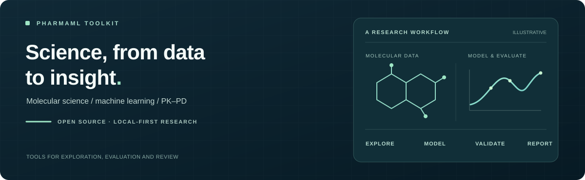

<p align="center">
  
</p>

<div align="center">

# PharmaML Toolkit

**An offline-first toolkit for pharmaceutical machine learning and molecular research.**

[](https://github.com/MrMMA2004/pharma-ml-toolkit/actions/workflows/ci.yml)
[](https://github.com/MrMMA2004/pharma-ml-toolkit/releases/latest)
[](pharma-ml-toolkit/pyproject.toml)
[](LICENSE)

[Get started](#get-started) · [Choose a workflow](#choose-a-workflow) · [Interfaces](#interfaces) · [Documentation](#documentation) · [Contribute](#contributing-and-citation)

</div>

---

Explore compound tables, train and evaluate models, simulate PK/PD, prepare docking workflows, and share results—all from a Python package with optional desktop and web interfaces. Core workflows run locally without a cloud account or API key; some domain features need extra packages or external tools.

> **For research and education, not clinical decision support.** Validate calculations, models and outputs for your data and intended use.

## Choose a workflow

| I want to… | Start here |
| :--- | :--- |
| **Inspect data and build QSAR models** | [ML walkthrough](pharma-ml-toolkit/examples/complete_ml_workflow.ipynb) · [Data splitting and leakage checks](pharma-ml-toolkit/docs/DATA_SPLITTING.md) |
| **Analyze concentration–time data** | [PK notebook](pharma-ml-toolkit/examples/complete_pk_workflow.ipynb) · [PK analysis script](pharma-ml-toolkit/examples/run_pk_analysis.py) |
| **Prepare and review docking experiments** | [Docking notebook](pharma-ml-toolkit/examples/complete_docking_workflow.ipynb) · [Docking batch script](pharma-ml-toolkit/examples/run_docking_batch.py) |
| **Explore generation or model uncertainty** | [Generative notebook](pharma-ml-toolkit/examples/complete_generative_workflow.ipynb) · [Conformal regression](pharma-ml-toolkit/docs/CONFORMAL_REGRESSION.md) · [Classification sets](pharma-ml-toolkit/docs/CONFORMAL_CLASSIFICATION.md) |
| **Use a visual interface** | [Studio and web console](#interfaces) |

## Get started

The Python package lives in the **inner** `pharma-ml-toolkit/` directory. These commands install the pinned core stack and inspect a bundled synthetic dataset; they do not require chemistry or GUI extras. Python 3.10–3.12 is used in CI.

```bash
git clone https://github.com/MrMMA2004/pharma-ml-toolkit.git
cd pharma-ml-toolkit/pharma-ml-toolkit

python -m venv .venv
source .venv/bin/activate                 # Windows PowerShell: .venv\Scripts\Activate.ps1
python -m pip install -r requirements.txt
python -m pip install --no-deps -e .

# Inspect the included classification data
pharmaml data inspect --data examples/data/qsar_classification.csv --target activity --head 3
```

You should see a dataset summary, target-class counts and the first three rows. The command reports which non-numeric columns are excluded from model features; the original file is not changed. Replace the path and target with your own CSV, TSV or Excel data when ready.

<details>
<summary><strong>Try the Python API instead</strong></summary>

```python
from pharmaml.pharma.pk import half_life

print(f"Half-life: {half_life(0.35):.2f} hours")  # ke = 0.35 per hour
```

This is a simple first-order calculation, not a patient-specific recommendation. See the [PK workflow](pharma-ml-toolkit/examples/complete_pk_workflow.ipynb) for a fuller example.

</details>

**Next steps:** run `pharmaml --help`, explore the [example notebooks](pharma-ml-toolkit/examples/), or read the [full installation guide](pharma-ml-toolkit/README.md#installation) for chemistry, docking, deep learning and other optional dependencies. The project is distributed from GitHub and versioned source archives, not a PyPI release.

## Interfaces

| Interface | Best for | How to start |
| :--- | :--- | :--- |
| **Python & CLI** | Scripts, notebooks and reproducible local workflows | Follow [Get started](#get-started); run `pharmaml --help` |
| **PharmaML Studio** | Exploring toolkit workflows in a desktop UI | Install the optional PySide6 Studio dependencies described in `requirements.txt`, then run `python studio.py` from the inner toolkit directory. See the [Studio guide](pharma-ml-toolkit/README.md#graphical-interface--pharmaml-studio). |
| **Web console** | Browsing the package, documentation and downloads | From the repository root, run `bun install` and `bun run dev`, then open `http://localhost:3000`. See [web development](CONTRIBUTING.md#web-console-development). |

The Python package and web console can be used independently. The screenshot below is a **historical v1.2.161 capture**, not a claim about the current interface or test count.

<details>
<summary><strong>See the web console</strong></summary>
<p align="center">
  
</p>
</details>

## Documentation

| Resource | What you will find |
| :--- | :--- |
| [Full user guide](pharma-ml-toolkit/README.md) | Installation, domain workflows, CLI, testing and troubleshooting |
| [API & module index](pharma-ml-toolkit/docs/INDEX.md) | Package map and detailed reference links |
| [Example notebooks](pharma-ml-toolkit/examples/) | Executed workflows for ML, PK, docking, cell lines, generation and tuning |
| [Scientific guides](pharma-ml-toolkit/docs/) | [Data splitting](pharma-ml-toolkit/docs/DATA_SPLITTING.md), [coverage diagnostics](pharma-ml-toolkit/docs/COVERAGE_DIAGNOSTICS.md), [MD plots](pharma-ml-toolkit/docs/MD_VISUALIZATION.md), [multi-objective optimization](pharma-ml-toolkit/docs/MULTIOBJECTIVE_WORKFLOW.md), and more |
| [Changelog](pharma-ml-toolkit/CHANGELOG.md) | Versioned changes and recorded verification evidence |

The latest **GitHub release** and the version in a repository checkout can differ. Use the [release page](https://github.com/MrMMA2004/pharma-ml-toolkit/releases/latest) for the latest published release, or the [changelog](pharma-ml-toolkit/CHANGELOG.md) for the checked-in source history. To use a downloaded source ZIP, extract it and run the installation commands from its inner `pharma-ml-toolkit/` directory.

## Repository at a glance

```text
pharma-ml-toolkit/          Python package, Studio, notebooks and detailed docs
src/                        Next.js web console
scripts/                    Repository and web integration tools
tests/                      Web/toolkit integration checks
download/                   Versioned archives and reference assets
```

## Contributing and citation

Bug reports and focused pull requests are welcome. Read the [contribution guide](CONTRIBUTING.md), [code of conduct](CODE_OF_CONDUCT.md) and [security policy](SECURITY.md). For reproducible research, record the exact version or commit used; see [CITATION.cff](CITATION.cff) and the [release history](https://github.com/MrMMA2004/pharma-ml-toolkit/releases).

Distributed under the [MIT License](LICENSE).
