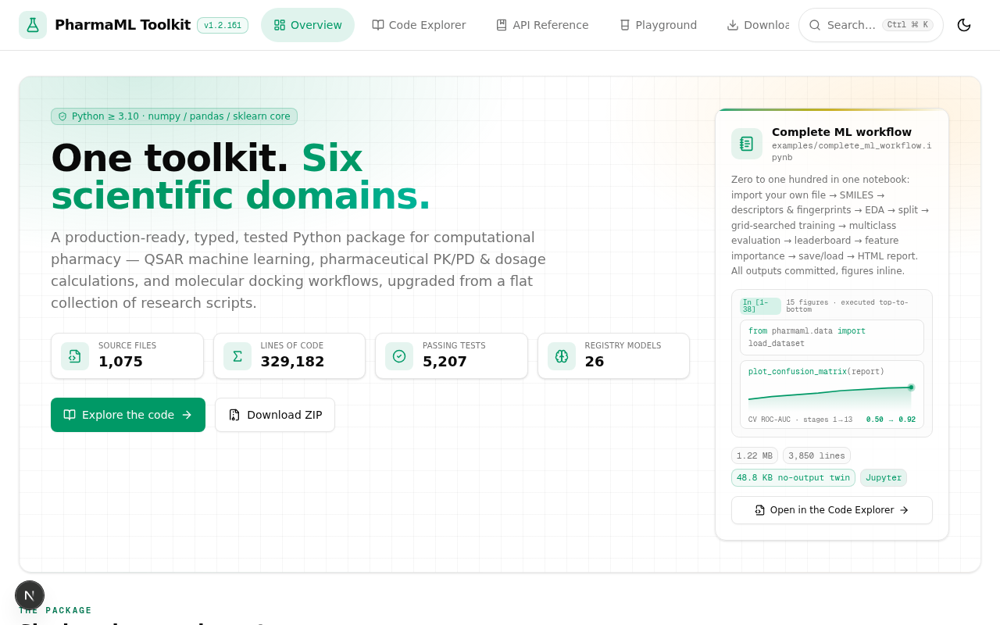

<p align="center">
  
</p>

<div align="center">

# PharmaML Toolkit

**From compound data to research insight.**

A local-first toolkit for pharmaceutical machine learning, molecular research and PK/PD.

[](https://github.com/MrMMA2004/pharma-ml-toolkit/actions/workflows/ci.yml)
[](https://github.com/MrMMA2004/pharma-ml-toolkit/releases/latest)
[](pharma-ml-toolkit/pyproject.toml)
[](LICENSE)

[Get started](#get-started) · [Explore workflows](#explore-workflows) · [Research checks](#research-checks) · [Interfaces](#interfaces) · [Desktop direction](#desktop-direction) · [Documentation](#documentation) · [Contribute](#contributing-and-citation)

</div>

---

PharmaML brings data exploration, QSAR modeling, cheminformatics, docking, PK/PD and scientific visualization together in a Python package. Work through notebooks, scripts or the desktop Studio; use the companion web console to browse the project. Core workflows run locally without a cloud account or API key. Some features need optional packages or external engines.

> **Research and education only — not clinical decision support.** Independently validate calculations, models and outputs for your data and intended use.

## Get started

The Python package is in the **inner** `pharma-ml-toolkit/` directory. The following installs the pinned core dependencies and inspects a bundled synthetic dataset. CI exercises Python 3.10–3.12; chemistry and GUI extras are not needed for this example.

```bash
git clone https://github.com/MrMMA2004/pharma-ml-toolkit.git
cd pharma-ml-toolkit/pharma-ml-toolkit

python -m venv .venv
source .venv/bin/activate                 # Windows PowerShell: .venv\Scripts\Activate.ps1
python -m pip install -r requirements.txt
python -m pip install --no-deps -e .

pharmaml data inspect --data examples/data/qsar_classification.csv --target activity --head 3
```

The command prints a dataset summary, target-class counts and the first three rows without changing the input file. Non-numeric columns excluded from model features are reported. To use your own table, replace the path and target; CSV, TSV and Excel are supported.

<details>
<summary><strong>Try the Python API</strong></summary>

```python
from pharmaml.pharma.pk import half_life

print(f"Half-life: {half_life(0.35):.2f} hours")  # elimination rate: 0.35 per hour
```

This first-order calculation is an illustration, not a patient-specific recommendation. See the [PK notebook](pharma-ml-toolkit/examples/complete_pk_workflow.ipynb) for a fuller workflow.

</details>

Run `pharmaml --help` to explore the CLI. For optional chemistry, docking, reporting, deep-learning or Studio dependencies, see the [installation guide](pharma-ml-toolkit/README.md#installation) and the commented blocks in [`requirements.txt`](pharma-ml-toolkit/requirements.txt). The pinned requirements and loose-range extras are alternative installation approaches; use the guide when choosing an environment.

## Explore workflows

| Area | What you can do | Start here |
| :--- | :--- | :--- |
| **Data & QSAR** | Inspect tables, split data, train and evaluate models. | [ML notebook](pharma-ml-toolkit/examples/complete_ml_workflow.ipynb) · [Data splitting](pharma-ml-toolkit/docs/DATA_SPLITTING.md) |
| **Validation & uncertainty** | Audit exact split overlap, run nested CV and examine held-out conformal intervals or classification sets. | [Research workflows](pharma-ml-toolkit/docs/RESEARCH_WORKFLOWS.md) · [Conformal regression](pharma-ml-toolkit/docs/CONFORMAL_REGRESSION.md) · [Classification sets](pharma-ml-toolkit/docs/CONFORMAL_CLASSIFICATION.md) |
| **Chemistry & generation** | Calculate descriptors and fingerprints, compare molecules and explore molecular generation. | [Chemistry API](pharma-ml-toolkit/docs/INDEX.md) · [Generative notebook](pharma-ml-toolkit/examples/complete_generative_workflow.ipynb) · [Studio genetic search](pharma-ml-toolkit/docs/RESEARCH_WORKFLOWS.md#genetic-search-in-studio) |
| **Docking** | Prepare inputs, review Vina campaigns and inspect or parse results. | [Docking notebook](pharma-ml-toolkit/examples/complete_docking_workflow.ipynb) · [Reviewed Vina workflow](pharma-ml-toolkit/docs/RESEARCH_WORKFLOWS.md#vina-campaign-review-and-launch-in-studio) |
| **PK/PD** | Explore concentration–time data, pharmaceutical calculations and simulations. | [PK notebook](pharma-ml-toolkit/examples/complete_pk_workflow.ipynb) · [PK analysis script](pharma-ml-toolkit/examples/run_pk_analysis.py) |
| **Cell-line research** | Analyze drug-response screens and explore expression and biomarkers. | [Cell-line notebook](pharma-ml-toolkit/examples/complete_cellline_workflow.ipynb) |
| **Reports & visualization** | Plot results and export tables or reports for review. | [Full user guide](pharma-ml-toolkit/README.md) · [MD visualization](pharma-ml-toolkit/docs/MD_VISUALIZATION.md) |

Notebooks use included example data; look for the `_no_output` twins in [examples](pharma-ml-toolkit/examples/) when you want a smaller starting point. Optional dependencies vary by workflow.

## Research checks

These are focused tools to support a research workflow, not a complete validation platform. The [research workflow guide](pharma-ml-toolkit/docs/RESEARCH_WORKFLOWS.md) documents inputs, CLI commands, Studio entry points and limitations.

- **Data quality and leakage.** Audit missing values, duplicates and exact identifier overlap across splits. In Studio, use **Data Explorer → Run data audit** or **Audit separate files…** for text-preserving file-based checks; the CLI also offers a separate-file audit. Exact-key checks do not detect similar compounds or prove independence; choose the leakage unit appropriate to your study. [Data-quality guide](pharma-ml-toolkit/docs/RESEARCH_WORKFLOWS.md#data-quality-in-studio)
- **Held-out uncertainty.** Separate train, calibration and test files support fixed ridge conformal intervals and logistic classification sets. Marginal coverage depends on exchangeability; subgroup results are empirical, not guarantees. Keep test data out of model selection. The older Statistics-tab tools split their scored rows for calibration and evaluation, but cannot verify independence from model fitting or selection. [Regression](pharma-ml-toolkit/docs/RESEARCH_WORKFLOWS.md#held-out-regression-uncertainty) · [Classification](pharma-ml-toolkit/docs/RESEARCH_WORKFLOWS.md#held-out-classification-uncertainty) · [Statistics-tab limitations](pharma-ml-toolkit/docs/RESEARCH_WORKFLOWS.md#statistics-tab-conformal-and-subgroup-tools)
- **Validation and calibration.** [Nested ridge and logistic CV](pharma-ml-toolkit/docs/RESEARCH_WORKFLOWS.md#nested-validation) can use group-disjoint folds. [Binary probability recalibration](pharma-ml-toolkit/docs/RESEARCH_WORKFLOWS.md#binary-probability-recalibration-separate-from-conformal) is a separate workflow, not conformal calibration; neither replaces independent external evaluation.
- **Docking review.** Studio offers [input preparation](pharma-ml-toolkit/docs/RESEARCH_WORKFLOWS.md#prepare-docking-inputs-in-studio) and reviewed sequential Vina launch. The [campaign inspector](pharma-ml-toolkit/docs/RESEARCH_WORKFLOWS.md#inspecting-an-interrupted-vina-campaign) reports recorded progress and missing, changed or unrecorded files. It is read-only: it does not resume reviewed campaigns or determine whether a process is active. Use suitable inputs and a trusted external engine, and inspect results independently.
- **Provenance and diagnostics.** Opt-in [CLI training records](pharma-ml-toolkit/docs/RESEARCH_WORKFLOWS.md#observed-ml-train-run-records-opt-in), Studio's declared-manifest creator and comparisons, environment and data-drift diagnostics, and [checkpoint inspection](pharma-ml-toolkit/docs/RESEARCH_WORKFLOWS.md#checkpoint-inspection) help document and investigate runs. A declared manifest is not an observed training record. Hashes and matching reports do not certify reproducibility or scientific validity; review reports for sensitive metadata before sharing.
- **Genetic search.** Studio reports generation progress and can request a cooperative stop; partial results are in memory only. Studio does not offer GA checkpoint resume. The lower-level checkpoint path has a restricted objective whitelist and rejects mismatched or damaged checkpoints; see the [checkpoint limits](pharma-ml-toolkit/docs/CHECKPOINT_SCHEMA.md#genetic-checkpoint-compatibility-and-limits).

## Interfaces

| Interface | Best for | How to start |
| :--- | :--- | :--- |
| **Python & CLI** | Scripts, notebooks and local workflows | Follow [Get started](#get-started); run `pharmaml --help` |
| **PharmaML Studio** | Desktop access to toolkit workflows | Enable the optional Studio GUI dependencies in `requirements.txt`, then run `python studio.py` from the inner toolkit directory. See the [Studio guide](pharma-ml-toolkit/README.md#graphical-interface--pharmaml-studio). |
| **Web console** | Browsing the package, documentation and downloads | From the repository root, run `bun install` and `bun run dev`, then open `http://localhost:3000`. See [web development](CONTRIBUTING.md#web-console-development). |

The Python package and web console can be used independently. The image below is a **historical v1.2.161 capture**, not a claim about the current interface or test count.

<details>
<summary><strong>See the web console</strong></summary>
<p align="center">
  
</p>
</details>

## Desktop direction

The current Studio in this checkout is the **PySide6 desktop application**. The separate web console is a **Next.js** application; it is not an offline Tauri desktop build. Use the existing Studio instructions above for the interface available today.

The supplied *MASTER PROMPT part11* describes a **target migration**, not a completed release: an offline React/TypeScript interface built with Vite inside Tauri 2 and WebView2, backed by a local Python/FastAPI service with REST and WebSocket communication and SQLite. Its intended nine-workspace navigation is Introduction, Datasets, Machine Learning, Deep Learning, Generative AI, Molecular Docking, PK/PD, Molecular Dynamics Analysis and Visualization.

The requested target also calls for complete scientific-workflow integration, Plotly.js and Three.js visualization, and a standalone Windows installer. **This migration, end-to-end parity, offline installation and clean-Windows verification are not established by the current checkout.** Existing PySide6 Studio should remain available until replacement workflows and retirement are verified; do not interpret the source ZIP or web console as the requested standalone installer. See [releases and testing](#releases-and-testing) for what is currently published and tested.

## Documentation

| Resource | What you will find |
| :--- | :--- |
| [Full user guide](pharma-ml-toolkit/README.md) | Installation, domain workflows, CLI, testing and troubleshooting |
| [API & module index](pharma-ml-toolkit/docs/INDEX.md) | Package map and reference links |
| [Research workflows](pharma-ml-toolkit/docs/RESEARCH_WORKFLOWS.md) | CLI and Studio instructions, assumptions and current limitations |
| [Example notebooks and scripts](pharma-ml-toolkit/examples/) | ML, PK, docking, cell lines, generation, deep learning and tuning |
| [Scientific guides](pharma-ml-toolkit/docs/) | [Data splitting](pharma-ml-toolkit/docs/DATA_SPLITTING.md), [coverage diagnostics](pharma-ml-toolkit/docs/COVERAGE_DIAGNOSTICS.md), [multi-objective optimization](pharma-ml-toolkit/docs/MULTIOBJECTIVE_WORKFLOW.md) and more |
| [Changelog](pharma-ml-toolkit/CHANGELOG.md) | Source history and recorded verification evidence |

## Releases and testing

The latest **GitHub release** and a repository checkout may differ. Use the [release page](https://github.com/MrMMA2004/pharma-ml-toolkit/releases/latest) for published releases and the [changelog](pharma-ml-toolkit/CHANGELOG.md) for checked-in source history. Source archives are also kept in [`download/`](download/); after extracting one, install from its inner `pharma-ml-toolkit/` directory. The project is distributed from GitHub and versioned source archives, not a PyPI release.

CI covers the GitHub page, Python versions, selected scientific workflows and other integration checks; see the [workflow](.github/workflows/ci.yml) for its current scope. For local development and focused tests, follow the [contribution guide](CONTRIBUTING.md#python-development) and [testing guide](pharma-ml-toolkit/README.md#testing). Optional dependencies and platform-specific tools affect which checks can run.

## Repository at a glance

```text
pharma-ml-toolkit/          Python package, Studio, notebooks and detailed docs
src/                        Next.js web console
scripts/                    Repository and web integration tools
tests/                      Web/toolkit integration checks
download/                   Versioned archives and reference assets
```

## Contributing and citation

Bug reports and focused pull requests are welcome. Read the [contribution guide](CONTRIBUTING.md), [code of conduct](CODE_OF_CONDUCT.md) and [security policy](SECURITY.md); report security concerns through the policy rather than a public issue. Do not submit credentials, patient information or private datasets.

For research, record the exact version or commit and cite the software using [CITATION.cff](CITATION.cff) or GitHub's **Cite this repository** feature. See the [release history](https://github.com/MrMMA2004/pharma-ml-toolkit/releases) for published versions.

Distributed under the [MIT License](LICENSE).
