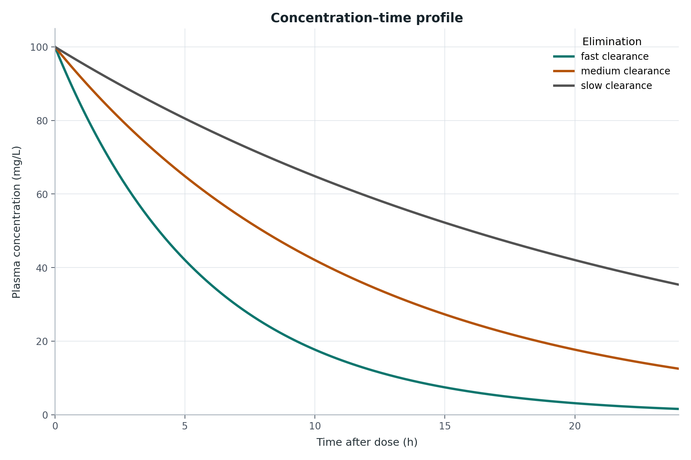

<div align="center">

# PharmaML Toolkit

### Pharmaceutical machine learning, from compound table to reproducible report

**An offline-first Python toolkit, graphical playground and web console for cheminformatics, QSAR, PK/PD, docking, explainable AI and scientific visualization.**

[](pharma-ml-toolkit/CHANGELOG.md)
[](pharma-ml-toolkit/pyproject.toml)
[](pharma-ml-toolkit/LICENSE)
[](pharma-ml-toolkit/examples/)

[Quick start](#quick-start) ·
[Capabilities](#capabilities) ·
[Examples](#examples-and-documentation) ·
[Download v1.2.116](download/pharma-ml-toolkit-v1.2.116.zip) ·
[Full user guide](pharma-ml-toolkit/README.md)

</div>

---

PharmaML brings the repetitive parts of a computational-pharmacology workflow into one typed, testable package: load and profile a dataset, calculate molecular features, train and explain models, simulate concentration–time profiles, prepare docking campaigns, and export readable figures and reports. Core workflows run locally; there is no required cloud account, API key or hosted model service.

> **Research and education software.** PharmaML is not a clinical decision-support system. Validate models, calculations and generated outputs for your own data and intended use.

## Capabilities

| Area | What you can do |
| --- | --- |
| **Cheminformatics & QSAR** | Standardize SMILES, calculate RDKit descriptors and fingerprints, measure similarity, split datasets, train baselines and compare models. |
| **PK/PD & pharmacometrics** | Run non-compartmental analysis, compartment and PBPK simulations, population PK, sensitivity analysis and PK/PD diagnostics. |
| **Docking & molecular workflows** | Prepare ligands and receptors, calculate grid boxes, run AutoDock Vina-compatible workflows and analyze docking results. |
| **Explainable & generative ML** | Inspect feature effects and applicability domains, use deep or ensemble models, and evaluate generated molecular libraries. |
| **Reports & visualization** | Create accessible Matplotlib figures, HTML/SVG/PDF exports, model cards, dataset reports and reproducible run manifests. |
| **Desktop & web interfaces** | Explore the same package through a local graphical playground or browse code, APIs, notebooks and downloads in the included web console. |

<p align="center">
  <a href="pharma-ml-toolkit/examples/chart_readability.py">
    
  </a>
  <br>
  <sub>A deterministic PK visualization generated by <a href="pharma-ml-toolkit/examples/chart_readability.py"><code>examples/chart_readability.py</code></a>. No downloaded data or display server required.</sub>
</p>

## Quick start

### Python package and graphical playground

PharmaML supports **Python 3.10–3.12**. The project is currently distributed from GitHub and versioned ZIP archives, not as a PyPI release.

```bash
git clone https://github.com/MrMMA2004/pharma-ml-toolkit.git
cd pharma-ml-toolkit/pharma-ml-toolkit
python -m pip install -e ".[chem,reports]"

# Inspect the command-line interface
pharmaml --help

# Launch the local graphical playground
python playground.py
```

Prefer a downloaded snapshot? Get the **[v1.2.116 source ZIP](download/pharma-ml-toolkit-v1.2.116.zip)**, extract it, enter its `pharma-ml-toolkit/` directory and run the same editable-install command. See the [installation guide](pharma-ml-toolkit/README.md#installation) for optional docking, boosting, explainability, deep-learning and development dependencies.

### Web console

The repository root contains the Next.js explorer for the toolkit, including source browsing, API reference, playground documentation and archive downloads.

```bash
# From the repository root
bun install
bun run dev
```

Open `http://localhost:3000`. Run `bun run build` for a production build. The Python package and the web console can be used independently.

## Examples and documentation

Start with an executed notebook or jump directly to the reference material:

| Resource | Purpose |
| --- | --- |
| [Walkthrough notebook](pharma-ml-toolkit/examples/pharmaml_walkthrough.ipynb) | Guided tour of the package and its main workflows. |
| [Complete ML workflow](pharma-ml-toolkit/examples/complete_ml_workflow.ipynb) | End-to-end data, feature, model and evaluation example. |
| [Deep learning workflow](pharma-ml-toolkit/examples/complete_deep_learning_workflow.ipynb) | Neural and molecular-model examples. |
| [PK workflow](pharma-ml-toolkit/examples/complete_pk_workflow.ipynb) | Pharmacokinetic calculations and simulations. |
| [Docking workflow](pharma-ml-toolkit/examples/complete_docking_workflow.ipynb) | Ligand preparation, docking and result analysis. |
| [Generative workflow](pharma-ml-toolkit/examples/complete_generative_workflow.ipynb) | Molecular generation and evaluation. |
| [API & module index](pharma-ml-toolkit/docs/INDEX.md) | Package map and links into the detailed documentation. |
| [Chart readability guide](pharma-ml-toolkit/docs/CHART_READABILITY.md) | Figure sizing, typography, export formats and accessibility conventions. |
| [Full user guide](pharma-ml-toolkit/README.md) | Detailed domain coverage, CLI, deployment, testing and troubleshooting. |
| [Changelog](pharma-ml-toolkit/CHANGELOG.md) | Release history and migration notes. |

Every notebook also has a `*_no_output.ipynb` twin for a clean starting point. The committed executed versions make the examples readable directly on GitHub.

## Repository map

```text
pharma-ml-toolkit/
├── pharma-ml-toolkit/       Python package, desktop playground and full manual
│   ├── src/pharmaml/        Typed library source
│   ├── examples/            Executed notebooks and runnable scripts
│   ├── tests/               Python unit and integration tests
│   ├── docs/                Module, reporting and methodology guides
│   └── download/            Toolkit-local versioned archives
├── src/                     Next.js web console
├── public/                  Web assets
├── tests/                   Web/toolkit integration and parity tests
├── download/                Current and historical downloadable releases
└── upload/                  Distribution copies and project documents
```

## Verification and reproducibility

The v1.2.116 source release was validated with:

- **3,489 passing tests**, 44 skips and 24 environment-specific deselections;
- **120 notebook and path-leakage checks** across eight refreshed notebook pairs;
- **769 applicable doctests**, with zero failures and three skips;
- clean full-source **Ruff** and **mypy** checks; and
- archive integrity, fresh-import and chart-rendering smoke tests.

Native GUI/XRender execution was unavailable in the release environment; optional native GUI and RDKit-drawing tests remain explicitly excluded rather than silently skipped. Reproduction commands and the complete test inventory are in the [testing guide](pharma-ml-toolkit/README.md#testing) and [changelog](pharma-ml-toolkit/CHANGELOG.md).

## Contributing and license

Bug reports and focused pull requests are welcome. Keep changes offline-friendly, deterministic where practical, covered by tests, and documented when they alter public APIs or generated artifacts.

PharmaML is available under the [MIT License](pharma-ml-toolkit/LICENSE).
