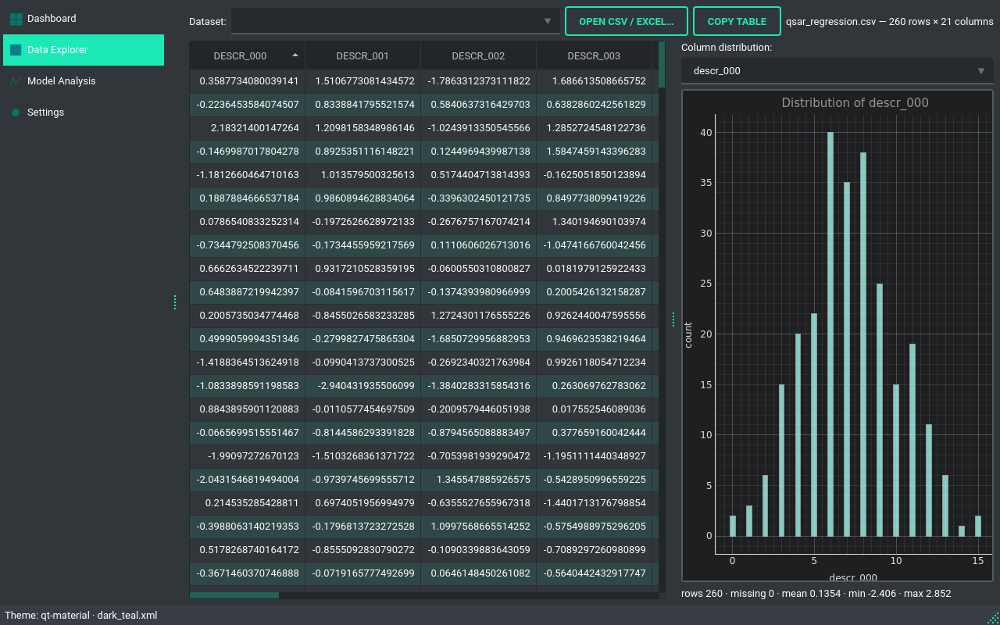
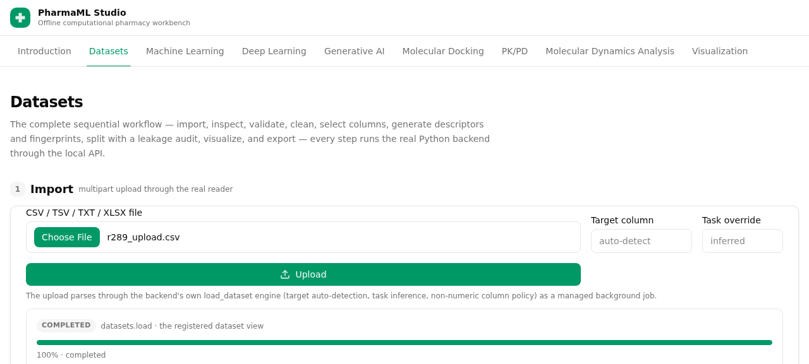

<p align="center">
  
</p>

<div align="center">

# PharmaML Toolkit

**An open-source toolkit for molecular data, pharmaceutical modeling and research workflows.**

[](https://github.com/MrMMA2004/pharma-ml-toolkit/actions/workflows/ci.yml)
[](https://github.com/MrMMA2004/pharma-ml-toolkit/releases/latest)
[](pharma-ml-toolkit/pyproject.toml)
[](LICENSE)

[Start here](#start-here) · [Research workflows](#research-workflows) · [Scientific practice](#scientific-practice) · [Interfaces](#choose-an-interface) · [Documentation](#documentation)

</div>

---

## About

PharmaML brings **cheminformatics, QSAR machine learning, molecular docking, PK/PD and visualization** together in a Python toolkit. Explore a dataset, prepare features, fit and evaluate a model, or investigate a molecular workflow using the API, command line, notebooks or desktop Studio.

Core workflows run locally without a cloud account or API key. Some workflows require optional packages or external engines. The separate web console is a project explorer; its capabilities are not interchangeable with the Python toolkit.

> **Research and education only.** This software is not clinical decision support. Independently validate data, calculations and outputs for your intended use.

## Start here

The installable Python package lives in the **inner** `pharma-ml-toolkit/` directory. This example installs the pinned core stack and inspects a bundled synthetic dataset; no chemistry or GUI extras are needed.

**1. Clone and enter the package directory**

```bash
git clone https://github.com/MrMMA2004/pharma-ml-toolkit.git
cd pharma-ml-toolkit/pharma-ml-toolkit
python -m venv .venv
```

**2. Activate the environment and install**

```bash
# macOS / Linux
source .venv/bin/activate
python -m pip install -r requirements.txt
python -m pip install --no-deps -e .
```

On Windows PowerShell, activate with `.venv\Scripts\Activate.ps1` instead, then run the same two `python -m pip install` commands. See the [installation guide](pharma-ml-toolkit/README.md#installation) for alternatives and optional dependencies.

**3. Inspect an example dataset**

```bash
pharmaml data inspect --data examples/data/qsar_classification.csv --target activity --head 3
```

The command prints a summary, target-class counts and three example rows without modifying the file. Replace the path and target to inspect your own CSV, TSV or Excel table. Run `pharmaml --help` to explore the CLI.

<details>
<summary><strong>Try a small Python API example</strong></summary>

```python
from pharmaml.pharma.pk import half_life

# First-order elimination rate constant: 0.35 per hour
print(f"Half-life: {half_life(0.35):.2f} hours")
```

This is a first-order illustration, not a patient-specific calculation. See the [PK workflow notebook](pharma-ml-toolkit/examples/complete_pk_workflow.ipynb) for a fuller example.

</details>

## Research workflows

Choose an entry point below. Features differ in their inputs and optional dependencies; the linked guides describe their scope.

- **Data & splitting** — inspect tables, audit quality and check exact identifier overlap across splits. [Data quality in Studio](pharma-ml-toolkit/docs/RESEARCH_WORKFLOWS.md#data-quality-in-studio) · [Data splitting](pharma-ml-toolkit/docs/DATA_SPLITTING.md)
- **QSAR modeling** — prepare features, train models and examine nested validation and uncertainty. [ML notebook](pharma-ml-toolkit/examples/complete_ml_workflow.ipynb) · [Nested validation](pharma-ml-toolkit/docs/RESEARCH_WORKFLOWS.md#nested-validation)
- **Molecular science** — compute descriptors and fingerprints, compare structures and explore generation. [Module index](pharma-ml-toolkit/docs/INDEX.md) · [Generative notebook](pharma-ml-toolkit/examples/complete_generative_workflow.ipynb)
- **Docking** — prepare inputs, review Vina campaigns and inspect recorded results. [Docking notebook](pharma-ml-toolkit/examples/complete_docking_workflow.ipynb) · [Reviewed Vina workflow](pharma-ml-toolkit/docs/RESEARCH_WORKFLOWS.md#vina-campaign-review-and-launch-in-studio)
- **PK/PD** — explore pharmaceutical calculations and concentration–time workflows. [PK notebook](pharma-ml-toolkit/examples/complete_pk_workflow.ipynb) · [PK analysis script](pharma-ml-toolkit/examples/run_pk_analysis.py)
- **Biological response** — analyze cell-line drug-response tables, expression and biomarkers. [Cell-line notebook](pharma-ml-toolkit/examples/complete_cellline_workflow.ipynb)
- **Visualization & reports** — plot, export and inspect results; compare selected run records. [Research workflows](pharma-ml-toolkit/docs/RESEARCH_WORKFLOWS.md) · [MD visualization](pharma-ml-toolkit/docs/MD_VISUALIZATION.md)

The [examples directory](pharma-ml-toolkit/examples/) contains notebooks and scripts; `_no_output` notebook versions provide a smaller starting point.

## Scientific practice

A typical project moves from **data review → split design → training → independent evaluation → reporting**. The tools support that process; they do not replace domain judgment or independent validation.

- **Prevent leakage.** Select an appropriate unit of separation—such as compound, patient or batch—before splitting. Exact-key overlap checks do not detect all related samples or prove independence.
- **Keep evaluation separate.** Fit preprocessing and models on training data; reserve calibration and test data for their intended roles. The separate-file workflows provide [regression intervals](pharma-ml-toolkit/docs/RESEARCH_WORKFLOWS.md#held-out-regression-uncertainty) and [classification sets](pharma-ml-toolkit/docs/RESEARCH_WORKFLOWS.md#held-out-classification-uncertainty). The older [Statistics-tab tools](pharma-ml-toolkit/docs/RESEARCH_WORKFLOWS.md#statistics-tab-conformal-and-subgroup-tools) cannot verify independence from model fitting or selection.
- **Interpret uncertainty carefully.** Conformal marginal coverage depends on exchangeability; subgroup estimates are empirical, not conditional guarantees. Small or dependent groups can make comparisons misleading.
- **Record and review.** [CLI training records](pharma-ml-toolkit/docs/RESEARCH_WORKFLOWS.md#observed-ml-train-run-records-opt-in), declared manifests and [checkpoint diagnostics](pharma-ml-toolkit/docs/RESEARCH_WORKFLOWS.md#checkpoint-inspection) help document a run. Declarations are not observed training records; matching hashes do not prove reproducibility or validity. Review metadata for sensitive information before sharing.
- **Know operational limits.** Docking depends on appropriate inputs and a trusted engine; the [campaign inspector](pharma-ml-toolkit/docs/RESEARCH_WORKFLOWS.md#inspecting-an-interrupted-vina-campaign) is read-only and does not resume a reviewed campaign. Studio's [genetic search](pharma-ml-toolkit/docs/RESEARCH_WORKFLOWS.md#genetic-search-in-studio) supports cooperative Stop with in-memory partial results, not GA resume.

For supported checkpoint objectives and refusal behavior, see the [genetic checkpoint limits](pharma-ml-toolkit/docs/CHECKPOINT_SCHEMA.md#genetic-checkpoint-compatibility-and-limits).

## Choose an interface

| Interface | Use it for | Start |
| :--- | :--- | :--- |
| **Python API & CLI** | Scripts, notebooks and local analysis | Follow [Start here](#start-here); run `pharmaml --help`. |
| **PharmaML Studio** | Desktop access to selected toolkit workflows | Install the optional Studio dependencies, then run `python studio.py` from the inner package directory. See the [Studio guide](pharma-ml-toolkit/README.md#graphical-interface--pharmaml-studio). |
| **Web console** | Browse project information and selected interactive tools | From the repository root, run `bun install` and `bun run dev`; open `http://localhost:3000`. See [web development](CONTRIBUTING.md#web-console-development). |

<details>
<summary><strong>See example interfaces</strong></summary>

**PySide6 Studio — historical Data Explorer capture.** The image illustrates a table and descriptor histogram; navigation and controls have changed since this capture. It uses bundled example data.

<p align="center">
  
</p>

**Next.js web console — historical v1.2.161 capture.** This is not a representation of the current interface or test count.

<p align="center">
  
</p>

**React migration frontend — round 289 browser capture.** This shows an in-progress Datasets workflow, not the existing PySide6 interface or a verified Windows installer.

<p align="center">
  
</p>
</details>

### Desktop migration status

The established desktop Studio uses **PySide6**. A React/TypeScript, Tauri 2 and local Python API migration is in progress alongside it; the [migration ledger](pharma-ml-toolkit/docs/MIGRATION_TAURI2.md) distinguishes implemented pieces from remaining work. **Complete workflow parity, PySide6 retirement and a clean-Windows-verified offline installer are not established.** The separate Next.js web console and source archives are not that installer.

## Documentation

| Resource | For |
| :--- | :--- |
| [Full user guide](pharma-ml-toolkit/README.md) | Installation, interfaces, workflows and troubleshooting |
| [API and module index](pharma-ml-toolkit/docs/INDEX.md) | Package reference and module map |
| [Research workflow guide](pharma-ml-toolkit/docs/RESEARCH_WORKFLOWS.md) | Inputs, assumptions, Studio entry points and limitations |
| [Example notebooks and scripts](pharma-ml-toolkit/examples/) | Starting points for ML, PK, docking, cell lines and generation |
| [Scientific guides](pharma-ml-toolkit/docs/) | Data splitting, conformal methods, coverage and visualization |
| [Changelog](pharma-ml-toolkit/CHANGELOG.md) | Source history and recorded verification evidence |

## Releases and development

A repository checkout and the latest GitHub release may differ. Visit [Releases](https://github.com/MrMMA2004/pharma-ml-toolkit/releases/latest) for published artifacts and [`download/`](download/) for versioned source archives; install a source archive from its inner package directory. The project is distributed through GitHub and source archives, not a PyPI release.

The CI badge above reports **main**, not this checkout. See the [workflow](.github/workflows/ci.yml) for its current test scope and the [testing guide](pharma-ml-toolkit/README.md#testing) for local checks. Optional dependencies and platform-specific tools affect what can run.

<details>
<summary><strong>Repository map</strong></summary>

```text
pharma-ml-toolkit/          Python package, Studio, examples and detailed docs
pharma-ml-toolkit/frontend/ React desktop-migration frontend (in progress)
pharma-ml-toolkit/src-tauri/ Desktop host (in progress)
src/                        Separate Next.js web console
scripts/                    Repository and web integration tools
tests/                      Web/toolkit integration checks
download/                   Versioned archives and reference assets
```

</details>

## Contributing and citation

Bug reports and focused pull requests are welcome. Read the [contribution guide](CONTRIBUTING.md), [code of conduct](CODE_OF_CONDUCT.md) and [security policy](SECURITY.md). Report security concerns through the policy rather than a public issue; do not submit credentials, patient information or private datasets.

For research, record the exact version or commit and cite the software using [CITATION.cff](CITATION.cff) or GitHub's **Cite this repository** feature. See the [release history](https://github.com/MrMMA2004/pharma-ml-toolkit/releases).

Distributed under the [MIT License](LICENSE).
